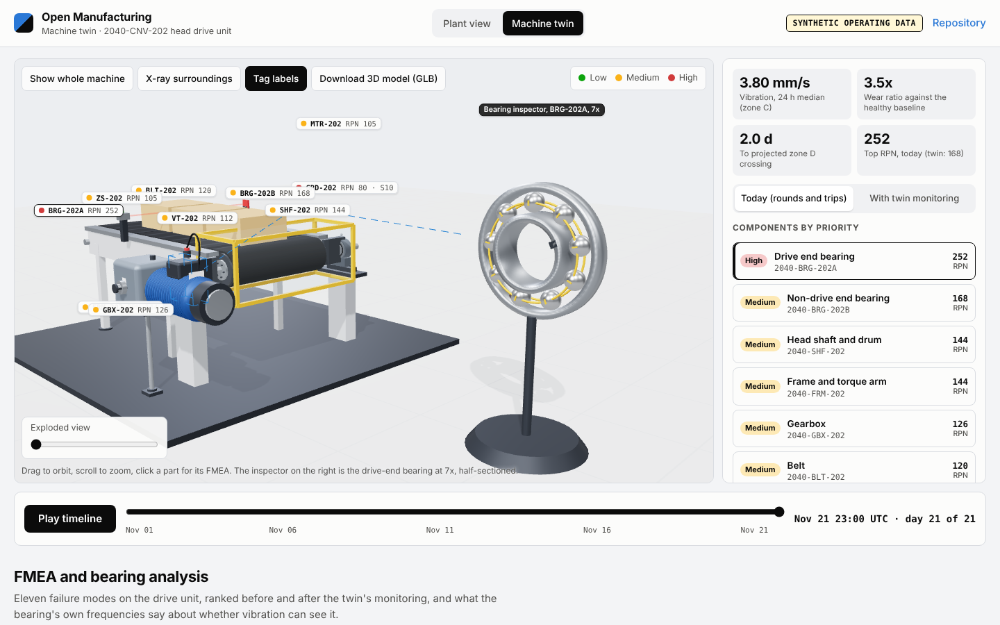
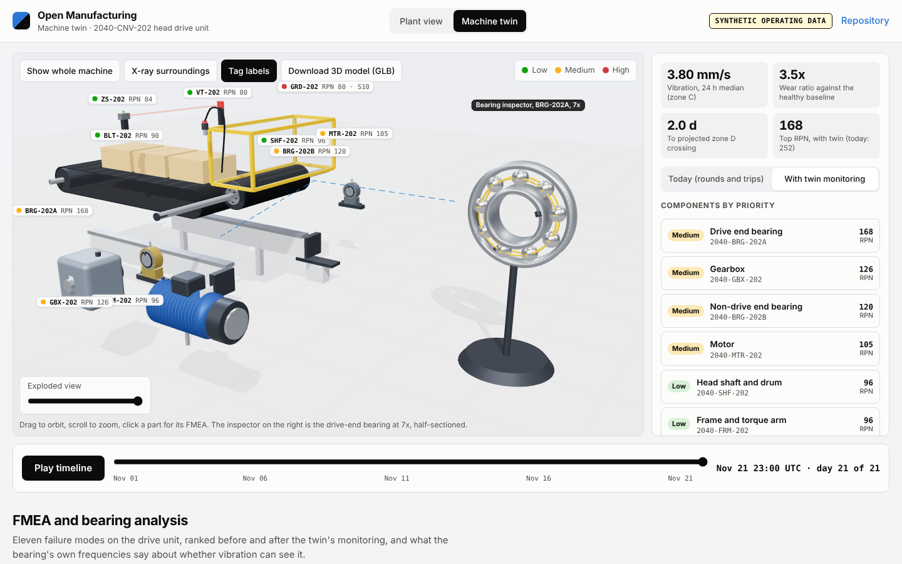
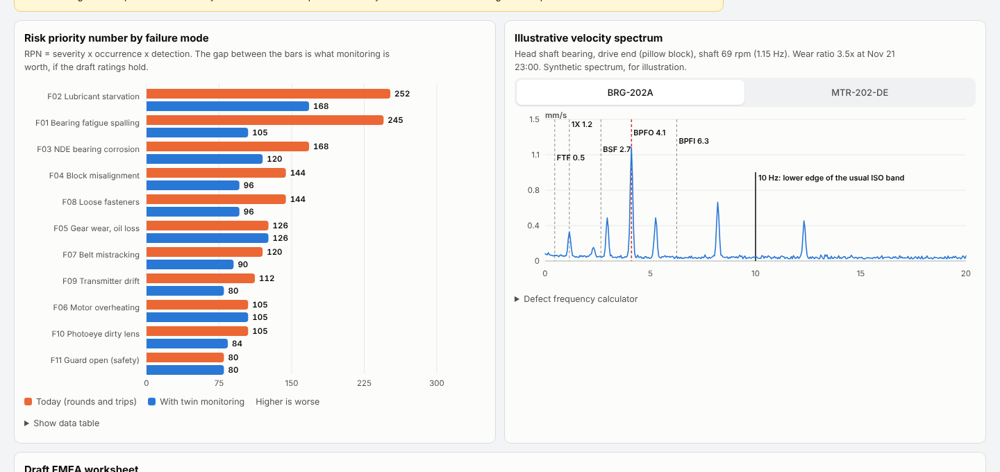
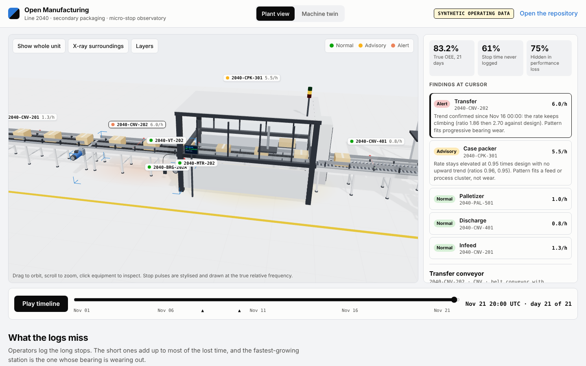

# Open Manufacturing

**Open-source 3D digital twin of a manufacturing machine, with FMEA and condition analysis.**
The twin is the head drive unit of a transfer conveyor (`2040-CNV-202`) on a simulated packaging line. It answers one narrow question:

> Can photoeye stop counts alone warn of a wearing drive bearing before vibration or a trip does, and what does the FMEA say about every other way this machine can fail?

Everything is reproducible and runs in the browser, including from `file://`. **All operating data is synthetic and the FMEA ratings are a single-author draft. Nothing here is measured from a real plant.**



*Machine twin: 3D drive unit with FMEA priority tags, a half-sectioned bearing inspector at 7x, KPIs, components ranked by RPN, and a 21 day timeline.*

## What you get

| Piece | What it does |
|-------|--------------|
| **Machine twin** (`web/machine.html`) | Ten components built from primitives: frame, head shaft and drum, two pillow block bearings, gearbox, motor, belt, guard, vibration transmitter, stop sensor. Orbit, fly-to, X-ray, exploded view, tag labels, GLB export. |
| **Bearing inspector** | Half-sectioned bearing, 9 balls, cage turning at the FTF ratio, outer-race spall that grows with the wear ratio, flash at each ball pass (BPFO rate). |
| **FMEA worksheet** | 11 failure modes, S/O/D on 1 to 10 scales, RPN ranking with a severity override (S of 9 or more is flagged), two detection columns: today (rounds and trips) and with twin monitoring. CSV download. |
| **Defect frequency calculator** | BPFO, BPFI, BSF, FTF from bearing geometry and shaft speed, plus a synthetic spectrum with sidebands that grow with wear. |
| **Plant view** (`web/index.html`) | Line 2040 in 3D, stop-rate charts, ISO vibration zones, logged versus captured stops, detector iterations. |
| **Simulator and benchmark** | Seeded generator, seven detector versions, Monte Carlo of 300 runs, threshold calibration, sensitivity. |
| **3D model** | `models/2040-cnv-202-drive-unit.glb`, exported from the page itself (about 1.1 MB). |

## Preview

### Exploded view and basis toggle



*Exploded view with the "With twin monitoring" basis: detection scores improve, so RPNs drop.*

### FMEA and bearing analysis



*RPN today versus with twin monitoring, and the head bearing spectrum with defect frequencies against the 10 Hz band edge.*

### Plant view



*Line 2040: station status follows the timeline cursor; the transfer conveyor alerts on a rising stop rate that fits progressive bearing wear.*

## Key findings (synthetic data, draft ratings)

**1. Detection is the lever.** Total RPN over the 11 failure modes falls from 1,601 to 1,150 (28%) when the stop-rate detector and a vibration transmitter are live. Severity and occurrence do not change, so the whole gain comes from earlier detection.

| Rank | Failure mode | S | O | D now | D twin | RPN now | RPN twin |
|------|--------------|---|---|-------|--------|---------|----------|
| 1 | Lubricant starvation, drive end bearing | 7 | 6 | 6 | 4 | 252 | 168 |
| 2 | Rolling contact fatigue, drive end bearing | 7 | 5 | 7 | 3 | 245 | 105 |
| 3 | Moisture corrosion, non-drive end bearing | 6 | 4 | 7 | 5 | 168 | 120 |
| 4 | Pillow block misalignment | 6 | 4 | 6 | 4 | 144 | 96 |
| 11 | Guard open during run | 10 | 2 | 4 | 4 | 80 | 80 |

The last row has the lowest RPN but severity 10, so the severity rule flags it. RPN alone would bury it.

**2. The monitored bearing turns too slowly for vibration alone.** With a 1,450 rpm motor, 21:1 gearbox and 160 mm drum, the head shaft runs at about 69 rpm (1.15 Hz) and its outer-race defect frequency is about 4.1 Hz, below the roughly 10 Hz lower edge of ISO 10816-style velocity bands. The stop-rate signal therefore does real work here. A pilot should add acceleration with crest factor or envelope analysis on the head shaft, or monitor the gearbox input shaft as well.

**3. Plant-level benchmark (N = 300 runs of 60 days, detector v6).**

| Metric | v6 | Target |
|--------|----|--------|
| False alarms per station-year | 0.89 | at most 1 |
| Wear alarm at least 7 days ahead | 95% | at least 80% |
| Chronic feed cluster found | 100% | at least 80% |
| Cause classified correctly | 98% wear, 100% non-wear | at least 85% |
| Actionable lead of at least 5 days | 74% | at least 75% (missed by 1 point) |

Demo window (seed 2040): 6,549 stops, true OEE 83.2%, 61% of stop time never logged.

## Quick start

```bash
npm install
npm run sim     # rebuild data/ for seed 2040 (21 day demo)
npm test        # 14 tests
npm run build   # bundle web/app.js and web/machine.js
# open web/machine.html or web/index.html (works from file://)
```

Useful extras:

```bash
node scripts/export-glb.mjs                       # rewrite models/*.glb (needs Chrome)
node scripts/shot.mjs machine-dashboard 1440 900 "t=503&sel=2040-BRG-202A" machine.html
N=300 node sim/calibrate.mjs                      # redo threshold calibration
```

URL parameters on the machine page: `t` (hour index), `sel` (part id), `basis=twin`, `explode` (0 to 100).

## How it was built

1. [Research](docs/01-research.md): candidate manufacturing problems and scoring.
2. [Define](docs/02-define.md): problem statement and targets fixed before any run.
3. [Analysis](docs/03-analysis.md): six-persona panel, three rounds, measured detector iterations.
4. [Solution](docs/04-solution.md): capture, detect, classify, act.
5. [Synthesis](docs/05-synthesis.md): answer, limits, pilot decision.
6. [FMEA and machine twin](docs/06-fmea.md): ratings, bearing kinematics, the low-speed finding.

## Repository layout

```
sim/      seeded generator, KPIs, detectors, Monte Carlo, calibration, bearing spectrum
data/     results.json, fmea.json, machine.json, CSV exports
web/      index.html (plant), machine.html (machine twin), style.css, src/, built bundles
models/   2040-cnv-202-drive-unit.glb
docs/     stage write-ups 01 to 06 and docs/img previews
scripts/  headless screenshots, GLB export
test/     node:test suite (14 tests)
```

## Method notes

- **FMEA scoring:** S, O, D on 1 to 10, RPN = S x O x D for ranking, plus a severity override. This follows the severity-first idea of the AIAG-VDA 2019 handbook but does not reproduce its Action Priority table, so it is not an AIAG-VDA FMEA.
- **Bearing failure modes** use the six ISO 15243 categories for naming.
- **Defect frequencies:** BPFO = (N/2) fr (1 - (d/D) cos a); BPFI = (N/2) fr (1 + (d/D) cos a); BSF = (D/2d) fr (1 - (d/D)^2 cos^2 a); FTF = (1/2) fr (1 - (d/D) cos a). Tests check BPFO + BPFI = N fr and BPFO = N FTF.

## Limits you should read

- FMEA ratings are one author's draft for a synthetic machine. A cross-functional team must re-rate them.
- Bearing geometry is assumed (6207-class head bearing) or an example (6205 motor bearing). Use the datasheet.
- The spectrum is synthetic and only shows where lines would sit.
- Circular validation: test data comes from the model family the detector assumes.
- Operator logging probabilities and the 4 h planned replacement are assumptions.
- The twin has no motor current, temperature or oil signal, so gearbox and motor rows do not improve.
- The 3D model is built from primitives, not a manufacturer CAD model. Visual checks ran under software rendering (SwiftShader) only.
- The panel in the analysis is one language model playing roles, not independent experts.
- Standards (ISO 22400-2, ISO 14224, ISO 10816-1, ISO 15243) are design references from secondary sources, not claimed compliance. Check ISO 20816-1 for the current vibration standard.

## Ringkasan (Bahasa Indonesia)

Proyek terbuka berisi digital twin 3D sebuah mesin (unit penggerak head conveyor transfer) lengkap dengan FMEA, inspektur bearing 7x, kalkulator frekuensi cacat bearing, dan model GLB yang bisa diunduh. Temuan utama (data sintetis, rating draft): total RPN turun 28% (1.601 menjadi 1.150) karena deteksi membaik; bearing yang dipantau berputar hanya sekitar 69 rpm sehingga frekuensi cacatnya sekitar 4,1 Hz, di bawah rentang umum pita getaran, jadi sinyal stop-rate memang berguna dan pilot perlu menambah akselerasi atau envelope. Semua data sintetis, jadi bukan bukti performa lapangan; langkah berikut adalah pilot 90 hari pada data nyata dan penilaian ulang FMEA oleh tim lintas fungsi.

## License

MIT.
